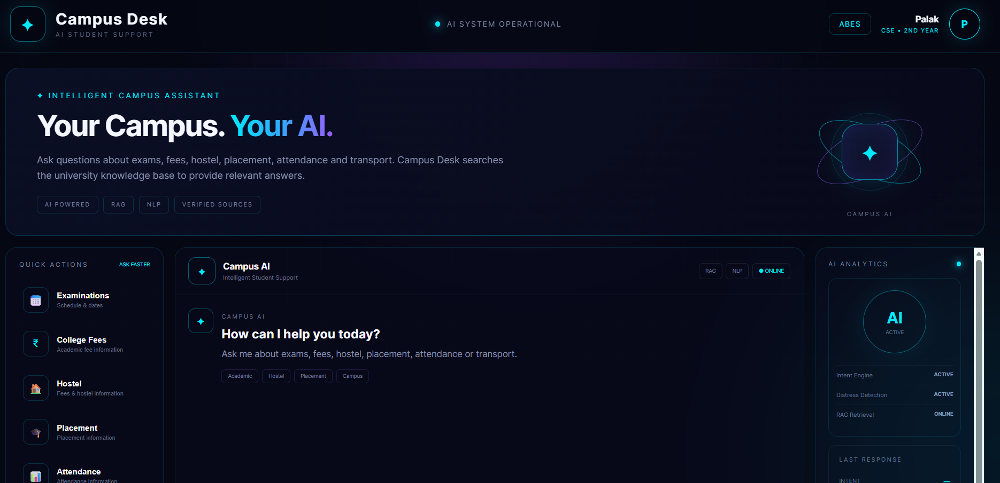
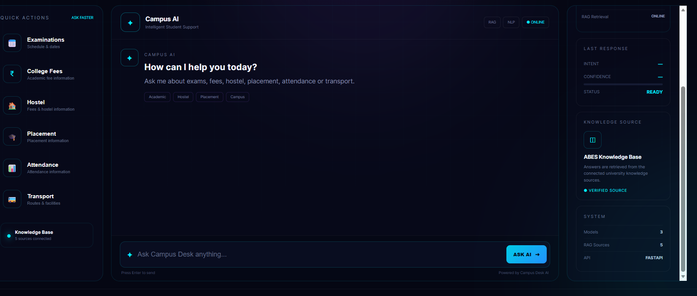
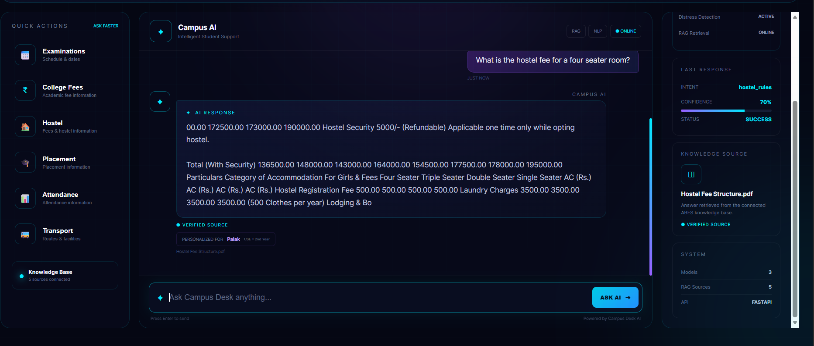

# 🚀 Campus Desk — AI-Powered Student Support

<p align="center">
  <strong>AI-Powered University Student Support Chatbot</strong>
</p>

<p align="center">
  NLP • Machine Learning • RAG • FastAPI • HTML • CSS • JavaScript
</p>

---

## 📌 Project Overview

**Campus Desk** is an AI/ML-based student support chatbot designed to provide quick answers to common university-related queries.

The system combines **NLP-based query classification, distress detection, and Retrieval-Augmented Generation (RAG)** over university knowledge documents.

### 🎓 Areas Covered

- 📝 Examinations
- 💰 College / Academic Fees
- 🏠 Hostel
- 💼 Placement
- 📊 Attendance
- 🚌 Transport
- 🎓 General Campus Support

---

## 🎯 Problem Statement

University support desks receive repetitive questions about examinations, fees, hostel, attendance, placements, and other campus services.

Campus Desk provides an AI-assisted interface that:

1. Understands the student's query.
2. Classifies the query intent.
3. Checks for distress-related messages.
4. Searches the university knowledge base.
5. Retrieves relevant information using semantic similarity.
6. Displays the source and confidence score.
7. Routes distress-related messages toward student support.

---

## 💡 Key Features

### 🤖 AI Query Classification

Supports 10 intents:

```text
exam_schedule
fee_query
attendance
hostel_rules
cgpa_query
course_registration
scholarship
library
transport
general_help

```

🛡️ Distress Detection

Uses a separate TF-IDF + Logistic Regression classifier to identify:

distress
normal


**🔎 RAG-Based Retrieval**

Relevant information is retrieved from university documents using:

Sentence Transformers
        ↓
Semantic Embeddings
        ↓
Cosine Similarity
        ↓
Relevant Knowledge Chunk


**📚 Source & Confidence**

The chatbot displays the retrieved document source and similarity-based confidence score.

**💻 Interactive Dashboard**

The frontend provides:

Chat interface
Quick questions
Intent information
Confidence score
Source information
AI / RAG status
System information


**🧠 AI / ML Pipeline**
```
Student Question
       ↓
Distress Detection
       ↓
Intent Classification
       ↓
Query Embedding
       ↓
Cosine Similarity
       ↓
Relevant Knowledge Chunk
       ↓
Source + Confidence
       ↓
Chatbot Response
```

```
Intent Classification
Question
   ↓
TF-IDF
   ↓
Logistic Regression
   ↓
Intent
Distress Classification
Question
   ↓
TF-IDF
   ↓
Balanced Logistic Regression
   ↓
Distress / Normal

```

**RAG Pipeline**
```
University Documents
        ↓
Text Extraction / OCR
        ↓
Cleaning
        ↓
Chunking
        ↓
Sentence Embeddings
        ↓
Knowledge Base
        ↓
Query Embedding
        ↓
Cosine Similarity
        ↓
Top Relevant Chunk
```

**🛠️ Technologies Used**
```
Technology	Purpose
Python	AI/ML and backend
Scikit-learn	Machine Learning
TF-IDF	Text feature extraction
Logistic Regression	Intent & distress classification
Sentence Transformers	Semantic embeddings
all-MiniLM-L6-v2	Embedding model
Cosine Similarity	Semantic retrieval
RAG	Knowledge retrieval
FastAPI	Backend REST API
Pydantic	API validation
HTML / CSS	Frontend
JavaScript	Frontend interaction
PyMuPDF	PDF processing
Tesseract OCR	OCR
Joblib	Model serialization
Pickle	RAG data serialization
Git / GitHub	Version control

```
**📚 Knowledge Base**

The current prototype uses five category-oriented PDF sources:

📅 Academic Calendar and Examination
🏠 Hostel Rules
💼 Campus Placement Record
💰 College Fees
🏠 Hostel Fee Structure

The knowledge base is a prototype dataset. Retrieved information should be verified against current official university information before real-world use.


**🔎 RAG Implementation**

The RAG system stores:

chunks
metadata
embeddings

Documents are processed through:

PDF → OCR/Text Extraction → Cleaning → Chunking
→ Sentence Embeddings → Knowledge Base

For each query:

Query → Embedding → Cosine Similarity
→ Top 3 Chunks → Best Result → Answer + Source
**📁 Project Structure**
```
Campus_Desk/
│
├── backend/
│   ├── main.py
│   ├── intent_model.pkl
│   ├── tfidf_vectorizer.pkl
│   ├── distress_model.pkl
│   ├── distress_vectorizer.pkl
│   └── rag_data.pkl
│
├── frontend/
│   ├── index.html
│   ├── style.css
│   └── script.js
│
├── screenshots/
│   ├── campus-desk-home.png
│   ├── campus-desk-chat.png
│   └── campus-desk-hostel-response.png
│
├── .gitignore
└── README.md
```
## 🖥️ Project Screenshots

### 🏠 Dashboard


### 💬 Chat Interface


### 📚 RAG Response



**🏗️ System Architecture**
```
                 ┌─────────────────────┐
                 │       Student       │
                 └──────────┬──────────┘
                            │
                            ▼
                 ┌─────────────────────┐
                 │   Web Dashboard     │
                 │   HTML + CSS + JS   │
                 └──────────┬──────────┘
                            │
                            ▼
                 ┌─────────────────────┐
                 │       FastAPI       │
                 │      Backend        │
                 └──────────┬──────────┘
                            │
                 ┌──────────┴──────────┐
                 ▼                     ▼
        ┌────────────────┐    ┌────────────────┐
        │ Distress Model │    │  Intent Model  │
        │  TF-IDF + LR   │    │  TF-IDF + LR   │
        └───────┬────────┘    └───────┬────────┘
                │                     │
                └──────────┬──────────┘
                           ▼
                 ┌─────────────────────┐
                 │   RAG Retrieval     │
                 │ Embeddings +        │
                 │ Cosine Similarity   │
                 └──────────┬──────────┘
                            │
                            ▼
                 ┌─────────────────────┐
                 │ University Knowledge│
                 │     Documents       │
                 └─────────────────────┘
```
**🔐 Limitations**
```
Custom prototype ML datasets are used.
Distress dataset is small and class-imbalanced.
Retrieval quality depends on available documents.
Similarity score is not a guaranteed factuality score.
University information can become outdated.
No production ERP/database integration.
Production deployment would require authentication, access control, monitoring, and data protection.
```
**🔮 Future Scope**
```
🌐 Hindi and Hinglish support
🧠 LLM-based RAG
🔎 Improved retrieval and reranking
📄 Document version management
🏫 ERP/LMS integration
🔐 Role-based access control
👤 Student personalization
🔔 Notifications and reminders
📊 Admin analytics dashboard
☁️ Production deployment
🔄 Continuous model retraining
```
**🎓 Academic Context**
```
Field	Details
Project	Campus Desk — AI-Powered Chatbot for University Student Support
Domain	Digital-Data-AI / AI & Machine Learning
Student	Palak Singh
Year	3rd Year
Branch	Computer Science & Engineering
Institute	ABES Engineering College, Ghaziabad
Supervisor	Ankit Sir — Data Scientist
Academic Year	2026–2027
```
**👩‍💻 Author**
```
Palak Singh
B.Tech — Computer Science & Engineering
ABES Engineering College, Ghaziabad
```

**📄 License**
```
This project is developed for academic and project demonstration purposes.
```
